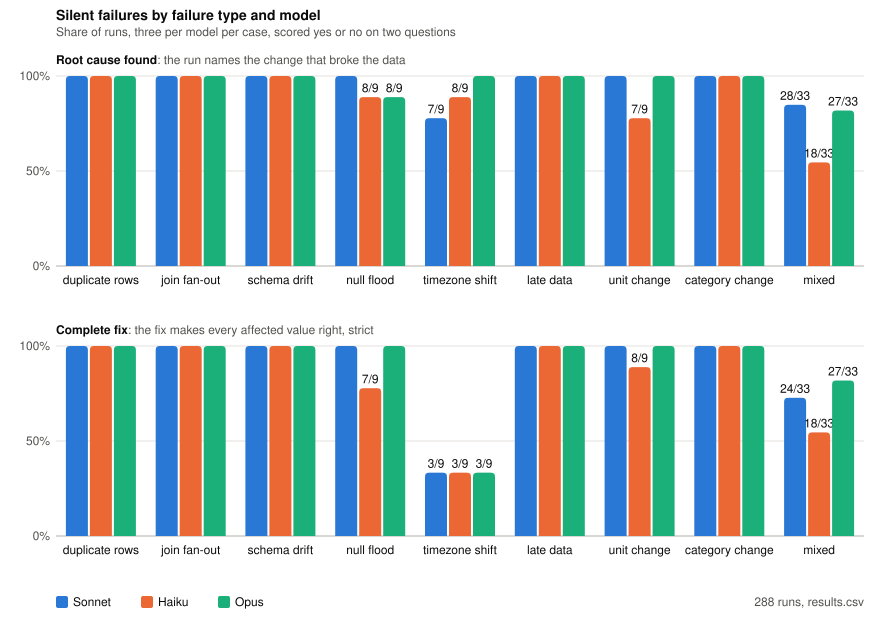

# dbt-silent-failures

Benchmark cases for "can a model find a data pipeline bug that raises no error". Each case takes dbt Labs'
`jaffle_shop` (DuckDB), breaks it with a script so `dbt build` still passes but the output is wrong, records
the ground truth, and scores a model's diagnosis.

## Reproduce

```bash
cd jaffle_shop
uv sync                 # needs uv and Python 3.13
uv run dbt build        # clean: 44 pass, sum(orders.amount) = 1672
cd ..
python3 cases/duplicate_payments/inject.py
cd jaffle_shop && uv run dbt build   # broken: 44 pass, sum(orders.amount) = 1852
git checkout seeds/raw_payments.csv  # undo
cd ..
python3 cases/gift_card_dollars/inject.py
cd jaffle_shop && uv run dbt build   # broken: 44 pass, sum(orders.amount) = 1469.05
git checkout seeds/raw_payments.csv  # undo
```

Check a number: `uv run python -c "import duckdb; print(duckdb.connect('jaffle_shop.duckdb').sql('select sum(amount) from orders'))"`

Check every case in one go (clean build passes, injection changes a model's output, `dbt build` still passes after it,
the key number in `ground_truth.md` matches), assemble a prompt, or run a model:

```bash
uv run --project jaffle_shop check_case.py                          # check all cases
uv run --project jaffle_shop check_case.py cases/gift_card_dollars  # check one
uv run --project jaffle_shop check_case.py cases/utc_switch --prompt      # print the frozen prompt (assembled if there is none yet)
uv run --project jaffle_shop check_case.py cases/utc_switch --run haiku   # run a model on the frozen prompt, save runs/standard/haiku-<n>.md
uv run --project jaffle_shop check_case.py cases/utc_switch --run sonnet --run haiku --run opus --times 3
uv run --project jaffle_shop check_case.py cases/utc_switch --prompt --samples curated   # the week 1 to 7 prompt, per-case queries
python3 reports/blind_sample.py   # 30 random runs with the verdicts removed, for a second scorer
```

## Layout

- `jaffle_shop/` vendored from [dbt-labs/jaffle_shop_duckdb](https://github.com/dbt-labs/jaffle_shop_duckdb) (Apache-2.0, license kept),
  grown so every failure type has something to break: `raw_orders.ordered_at` timestamps (`order_date` is derived),
  a `raw_customer_regions` feed joined inside `region_revenue`, `customers.completed_lifetime_value` filtered on status,
  `daily_revenue`, incremental with a three-day lookback, and (week 6) a `raw_payment_methods` lookup joined inside
  `orders` for a `fees` column. Clean totals are unchanged; the test count went 28 to 40 and then 44
- `cases/<name>/` one folder per case: `inject.py`, `ground_truth.md` (with the key number the check verifies), `prompt.md`
  (symptom text, whether seeds are shown, whether the build log is the full build or a models-and-tests build, and the
  per-case queries the week 1 to 7 runs got), `score.md`, `runs/<model>-<n>.md` for those runs, and `runs/standard/`
  with the frozen prompt (`prompt.md`, the standard output sample) and the `<model>-<n>.md` runs that answered it
- `check_case.py` checks a case, assembles its full prompt at run time (`--prompt`) and runs a model on it (`--run sonnet`)
- `logs/` clean and broken `dbt build` logs
- `reports/` weekly reports, the chart, the pilot summary and demo script, and `blind/` (30 runs for a second scorer,
  drawn by `blind_sample.py`; the key with the first verdicts is `blind_key.csv`, outside the folder)

## Cases

| Case | Type | What breaks | Sonnet, found / fixed | Haiku, found / fixed | Opus, found / fixed |
|---|---|---|---|---|---|
| duplicate_orders | duplicate rows | a two-week slice of February orders replayed with fresh ids, their payments re-keyed to them | 3 / 3 (3 / 3) | 3 / 3 (3 / 3) | 3 / 3 (3 / 3) |
| duplicate_payments | duplicate rows | 12 payments re-ingested with fresh ids | 3 / 3 (3 / 3) | 3 / 3 (3 / 3) | 3 / 3 (3 / 3) |
| coupon_cents | unit change | 6 of 13 coupon payments switch to dollars from 15 March, the rest stay in cents | 3 / 3 (3 / 3) | 1 / 0 (2 / 2) | 3 / 3 (3 / 3) |
| gift_card_dollars | unit change | 12 gift card payments sent in dollars, divided by 100 again | 3 / 3 (3 / 3) | 3 / 3 (3 / 3) | 3 / 3 (3 / 3) |
| transfers_in_micros | unit change | bank transfers from 15 March reported in micro-units, ten payments 10,000 times too large | 3 / 3 (3 / 3) | 3 / 3 (2 / 3) | 3 / 2 (3 / 3) |
| payment_methods_fanout | join fan-out | the processor feed lists bank transfers under two banks, every transfer counted twice inside `orders` | 3 / 3 (3 / 3) | 3 / 3 (3 / 3) | 3 / 3 (3 / 3) |
| processor_history | join fan-out | the payment-method lookup starts carrying history, every credit card payment counted twice in every month | 3 / 3 (3 / 3) | 3 / 3 (3 / 3) | 3 / 3 (3 / 3) |
| region_fanout | join fan-out | 8 customers' region rows re-sent, payments counted twice in the regional report | 3 / 3 (3 / 3) | 3 / 3 (3 / 3) | 3 / 3 (3 / 3) |
| regions_fanout_history | join fan-out | the regions feed starts carrying history, 6 customers move region and are counted in both | 3 / 3 (3 / 3) | 3 / 3 (3 / 3) | 3 / 3 (3 / 3) |
| payment_method_renamed | schema drift | payments feed writes `method` from 1 March, `payment_method` empty, the per-method columns go to 0 | 3 / 3 (3 / 3) | 3 / 3 (3 / 3) | 3 / 3 (3 / 3) |
| status_renamed | schema drift | orders feed renamed `status` to `order_status` from 1 March, old column empty | 3 / 3 (3 / 3) | 3 / 3 (3 / 3) | 3 / 3 (3 / 3) |
| join_drops_rows | null flood | second leg of every split payment arrives with no order id, 13 payments vanish from the marts | 3 / 3 (3 / 3) | 3 / 3 (2 / 2) | 3 / 3 (2 / 3) |
| null_order_dates | null flood | one week of March orders lands without a timestamp, March by order date is short, the dashboard keeps the old March | 3 / 3 (3 / 3) | 3 / 3 (3 / 3) | 3 / 3 (3 / 3) |
| null_payment_amounts | null flood | second instalments of 8 split orders land with no amount and `sum` skips them | 3 / 3 (3 / 3) | 3 / 2 (3 / 2) | 3 / 3 (3 / 3) |
| utc_reexport | timezone shift | the whole orders history re-exported in UTC, 14 orders land a day early across every month | 3 / 3 (3 / 3) | 3 / 3 (3 / 3) | 3 / 3 (3 / 3) |
| utc_switch | timezone shift | orders feed switched from local time to UTC on 1 March, 7 orders land a day early | 3 / 0 (3 / 0) | 1 / 0 (3 / 0) | 3 / 0 (3 / 0) |
| utc_switch_blind | timezone shift | the same, prompt without the example order | 1 / 0 (1 / 0) | 3 / 0 (2 / 0) | 2 / 0 (3 / 0) |
| late_orders | late data | 6 February orders backfilled in April, the incremental daily table never picks them up | 3 / 3 (3 / 3) | 3 / 3 (3 / 3) | 3 / 3 (3 / 3) |
| late_payments | late data | second instalments for 8 February orders land in April, the daily table keeps the old revenue | 3 / 3 (3 / 3) | 3 / 3 (3 / 3) | 3 / 3 (3 / 3) |
| status_new_value | category change | app writes `delivered` for completed orders from 10 March, `accepted_values` widened to hide it | 3 / 3 (3 / 3) | 3 / 3 (3 / 3) | 3 / 3 (3 / 3) |
| status_title_case | category change | app writes statuses in title case from 15 February, `accepted_values` widened to hide it | 3 / 3 (3 / 3) | 3 / 3 (3 / 3) | 3 / 3 (3 / 3) |
| category_and_units | mixed | `delivered` from 10 March plus coupon dollars from 15 March, one order in both, 1.98 left after the status fix | 3 / 3 (2 / 2) | 0 / 0 (0 / 0) | 3 / 3 (3 / 3) |
| duplicates_and_rename | mixed | the payment-method rename plus a retried first batch, five migrated payments loaded twice | 0 / 0 (0 / 0) | 0 / 0 (0 / 0) | 0 / 0 (0 / 0) |
| duplicates_and_units | mixed | twelve replayed payments plus gift cards in dollars, nearly cancelling in the total | 3 / 3 (3 / 3) | 3 / 2 (2 / 2) | 3 / 3 (3 / 3) |
| fanout_and_late | mixed | six February orders a month late, their customers' region rows re-sent with the backfill | 2 / 2 (3 / 1) | 3 / 3 (3 / 3) | 2 / 2 (3 / 3) |
| fanout_and_nulls | mixed | a second credit card row in the lookup plus eight NULL payment amounts, pulling the total both ways | 3 / 3 (3 / 3) | 2 / 3 (3 / 3) | 3 / 3 (3 / 3) |
| late_and_duplicate | mixed | the late orders plus 12 replayed payments in one load | 3 / 3 (3 / 3) | 3 / 3 (3 / 3) | 3 / 3 (3 / 3) |
| late_and_new_status | mixed | six February orders a month late, written as `delivered` like the March ones | 3 / 3 (3 / 3) | 3 / 2 (3 / 3) | 3 / 3 (3 / 3) |
| rename_and_new_status | mixed | the status rename plus `delivered` written in the new column only, hidden behind the NULLs | 3 / 3 (2 / 2) | 0 / 0 (1 / 1) | 3 / 3 (0 / 0) |
| units_and_rename | mixed | the payment-method rename plus the coupon dollars in one load | 3 / 3 (3 / 1) | 0 / 0 (0 / 0) | 3 / 2 (3 / 3) |
| rename_and_utc_v2 | mixed | `rename_and_utc` with order 73's warehouse row in the complaint (v2, standard sample only) | 3 / 3 (3 / 3) | 0 / 0 (2 / 2) | 3 / 3 (3 / 3) |
| late_and_timezone_v2 | mixed | `late_and_timezone` with the first backfilled order's warehouse timestamp in the complaint (v2, standard sample only) | 2 / 2 (3 / 3) | 0 / 0 (1 / 1) | 3 / 3 (3 / 3) |

The cells are runs out of three on the standard output sample (week 8), with the curated sample of weeks 1 to 7 in
brackets; the two v2 rows take their bracket from their v1, whose curated queries showed what the v2 text says. Each run is scored on two yes/no questions: **root cause found**, the run names the change that broke the
data (naming only the mechanism, hedging between the right cause and a wrong one, or handing the defect back for
someone else to decide, is no), and **complete fix**, the run's fix applied to the broken data makes every affected
value match the clean data (a fix that corrects some values is no; rebuild commands are not scored beyond a full
refresh where one is needed). `results.csv` has every run, with `samples` and `defects_found` (how many of the case's
injected defects the run named, 0 to 2); `score.md` in each case has the per-run notes and what was verified against
the data. Every case passes `check_case.py` with every test passing on both sides (40 before the week 6 lookup, 44
after) and with its frozen prompt matching what the case assembles today.

Two output samples. The runs of weeks 1 to 7 (`runs/`, `samples=curated`) got queries written per case in `prompt.md`
by someone who knew where the bug sat; every run from week 8 on (`runs/standard/`, `samples=standard`) gets the same
sample on every case: row counts per table, the raw column list, monthly totals of the output tables and ten rows of
every table picked by hash (`standard_queries` in `check_case.py`), so no query points at the bug. The standard
sample is the method from here; the curated runs are kept because the difference is itself a result (found 253 against
255 of 288, fixed 235 against 237, with 18 of the 96 case-and-model cells moving, 10 down and 8 up, where a curated
query had put the decisive row in view or the hash happened to). A case's prompt is frozen at its first run as
`runs/standard/prompt.md`, every later run answers that file, and a prompt that no longer matches the assembly is
refused, so a changed prompt is a new case: `rename_and_utc` and `late_and_timezone` got a v2 in week 9 with the
warehouse timestamp in the complaint, because the standard sample never shows it, and their v1 standard runs (2 / 0,
0 / 0, 0 / 0 and 2 / 2, 0 / 0, 3 / 3) stay in `results.csv` with `headline=no`, out of the table, the chart and the
totals. `reports/blind/` holds 30 random runs for a second scorer with the verdicts removed, `reports/blind_standard/`
the same for the standard runs; a second scorer scored the standard draw blind and agreed on 89 of 90 verdicts (root
cause 30 of 30, fix 29 of 30, defects 30 of 30), the one difference being `duplicates_and_units` standard haiku-3,
fixed here on its source-side removal of the copies matched to the processor's references and not fixed for the
second scorer because that removal is deferred.

Sonnet is `claude-sonnet-5-5`, Haiku is `claude-haiku-5-5` and Opus is `claude-opus-5-5`, run with
`claude -p --setting-sources ""`, tools off, three times each (Claude Code 2.1.296 for the curated runs, 2.1.299 for
the standard ones); the curated Opus runs on the first 21 cases were made in week 6 on the same project version the
other two models saw. Prompts from `region_fanout` on hide the seed data; cases from `duplicate_orders` on (week 4 and
later) get a models-and-tests build log instead of the full build (`Log: models only` in `prompt.md`), and every run
from week 5 on records the sha256 of the prompt it answered. `rename_and_utc` and `late_and_timezone` were each run
once on an earlier curated prompt before one clause was added; those runs and prompts are kept in `runs/first_prompt/`
under each case and are not in `results.csv`. A mixed case counts toward each of its two types for the four-per-type
target; `results.csv` keeps `mixed` as its type for the chart.


